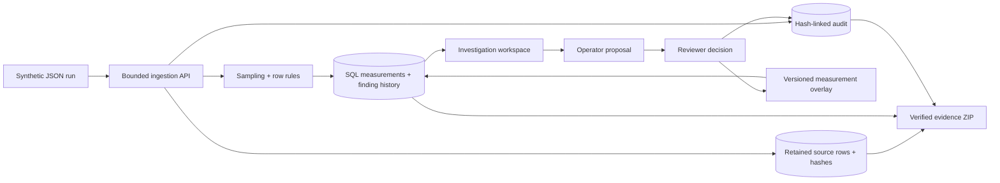

# Architecture and decisions

## Problem and implemented flow

An industrial team needs to distinguish a genuine process exception from missing, duplicated, malformed or mistranscribed data. This lab retains the source first, evaluates an explicit sampling plan, exposes row lineage and records versioned, reviewed corrections.

React runs the investigation UI. The same TypeScript service runs behind a local Node/SQLite adapter and a Cloudflare Worker/D1 adapter. Nine normalized SQL tables store workspaces, role-key hashes, batch masters, imports, source rows, measurements, finding history, proposals and audit events. Parameter values also have a numeric SQL column; invalid original values remain present in raw/current JSON until a reviewed correction is approved.

## Decision 001: Retain sources and reviewed overlays

Accepted for version 1. Raw records are never updated by a correction. Source hashes, file digests and row ordinals remain attached to current measurements. Exact/conflicting duplicates are retained and excluded, with the first batch/sample/stage/parameter row remaining canonical. Replacing the first reading silently was rejected because it hides source disagreement.

Corrections are restricted to value, exact unit, timestamp and equipment. They must remove at least one current finding and add none. Identity changes and conflicting duplicate disposition require a source investigation outside this scoped workflow. No automatic conversion or statistical imputation is performed.

## Decision 002: Versioned SQL transactions

Accepted for version 1. Every mutation checks the workspace revision. A transactional batch first advances that revision and records a random mutation token; every following write requires that same token. A losing concurrent operation writes neither data nor audit. Approval additionally checks the proposal's measurement version. SQL constraints protect primary keys, import request keys, source ordinals and audit revisions.

The Node adapter uses explicit SQLite transactions. The Worker uses the binding's transactional batch API, as documented by [Cloudflare D1](https://developers.cloudflare.com/d1/worker-api/d1-database/). Prepared statements bind all user values. Tables and columns come from application-owned allowlists.

## Decision 003: Bounded visitor workspaces

Accepted for version 1. Public visitors receive isolated 24-hour workspaces and three random role capabilities. Only SHA-256 key hashes are stored by the service; bearer keys remain in browser storage, never URLs, logs or exports. No workspace listing endpoint is provided. Operator can ingest/propose; Reviewer can decide; Observer can read. Both roles belong to the same demo visitor. This is permission simulation, not proof of two-person governance.

Workspaces expire with actual server checks and lazy SQL cleanup. Creation is globally limited to 20 per rolling minute and 200 unexpired workspaces. Per-workspace rows/imports/proposals are bounded. These are guardrails for a small public lab, not a capacity or availability commitment. A persistent multi-tenant production system would need real identity, managed retention, resource quotas and an operational threat model.

## Decision 004: Inspectable evidence, with clear limits

Accepted for version 1. Export verification recomputes source and import hashes, checks the audit chain and replays its imports/approvals to reconcile current measurements and complete finding history. Proposals and decisions reconcile to audit metadata. CSV cells are quoted and formula-leading text is neutralised. ZIP paths are fixed.

An inconsistent export is detected. An administrator rewriting data and all hashes remains outside this mechanism. The chain is not a digital signature, external timestamp or regulated audit guarantee.

## Rules and reconciliation

Each of three fictional batches expects sample S01 at Forming, with temperature 170-190 °C, thickness 1.8-2.2 mm and pressure 8-12 bar. All values are illustrative. Timestamps require exact UTC milliseconds within the declared production window. Unknown batches, unsupported fields, missing/non-numeric values, wrong units, invalid equipment, invalid timestamps and range failures are explicit findings.

Received rows reconcile to usable + quarantined + duplicates. Coverage is observed expected slots divided by nine. Quarantined readings count as observed, not usable. Unknown batch rows never count towards planned coverage. Completeness gaps become resolved history when a subsequent import supplies the slot.

## Operator runbook

| Symptom | Action |
| --- | --- |
| Open unit/type finding | Inspect source, propose a sourced correction, review explicitly |
| Missing expected slot | Obtain and ingest a separate synthetic source reading |
| Duplicate conflict | Investigate with the source owner; no silent canonical replacement |
| Revision conflict | Refresh, inspect new evidence, retry against the current revision |
| Stale proposal | Reject and submit against the current measurement version |
| Expired or lost access | Export beforehand; start a fresh synthetic workspace |
| Integrity mismatch | Stop export and investigate; never conceal the failed check |
| Wrong public build | Compare `/api/health` fingerprint with the release validation |

Public deployment uses Sites-managed D1 migrations, exact pushed source and an archive-backed Worker release. DNS changes are confined to `traceability.bestdev.co.il` and the issued validation TXT records. Roll back by deploying a previously validated Site version; database migrations must remain compatible.
